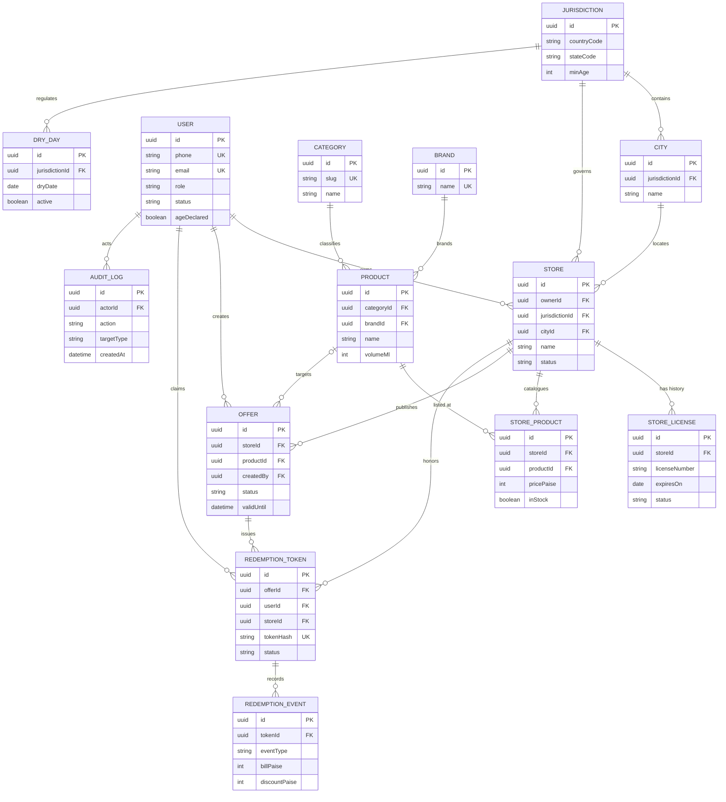

# t5 - BottleBazaar Fresh Schema and Migration Strategy

## Summary

The target persistence layer is PostgreSQL 16 with UUID identifiers, UTC
timestamps, integer paise monetary values, JSONB only for genuinely
schema-flexible payloads, and versioned SQL migrations. The design preserves
the current API's core entities (`users`, `stores`, `products`, `offers`,
`redemption_tokens`, `app_config`, and `audit_logs`) while adding explicit
email credentials, licences/evidence, dry days, inventory movements, and
analytics events required by the launch scope.

## Upstream Artifacts Consumed

- `H:\App\.github\modernize\rearchitecture\artifacts\spec.md` - actors,
  launch workflows, compliance rules, and out-of-scope payments/delivery.
- `H:\App\.github\modernize\rearchitecture\artifacts\data-model.md` - existing
  entity inventory, PostgreSQL field contracts, and redemption transaction
  boundaries.
- `H:\App\.github\modernize\rearchitecture\clarification.md` - fresh schema,
  additive/reversible transition, Sohna/Gurugram geography, and auth modes.
- `H:\App\.github\modernize\rearchitecture\artifacts\constitution.md` -
  PostgreSQL 16, reversible delivery, auditability, and server-side compliance.

## Evidence Mapping

- `data-model.md#Field inventory` -> preserve UUID IDs, PostgreSQL enums,
  JSONB configuration, paise pricing, and token-hash uniqueness.
- `data-model.md#Transaction boundaries` -> retain row-locking/idempotent
  reservation and redemption transactions.
- `spec.md#Merchant journeys 7-11` -> add licence, inventory, offer, QR,
  redemption value, and merchant analytics structures.
- `spec.md#Moderator and administrator journeys 12-15` -> add dry-day,
  configuration, moderation, immutable audit, and aggregate analytics support.
- `clarification.md#Backend` -> additive, reversible migrations and compatible
  existing contracts.

## Target Logical Model

### Identity and compliance

- `users`: one identity per normalized phone; nullable unique email; role,
  status, locale, and age-gate decision metadata.
- `password_credentials`: one row per user, Argon2id/bcrypt hash only; never
  store plaintext passwords.
- `otp_challenges`: hashed, purpose-bound, expiring, single-use challenges
  with attempt and lockout counters. Phone is retained for lookup/audit but
  never the OTP value.
- `sessions`: hashed refresh/session tokens, device metadata, expiry and
  revocation.
- `user_consents`: append-only policy acceptance records.
- `jurisdictions`, `cities`, `pin_codes`: normalized launch geography.
- `dry_days`: jurisdiction-scoped dates with reason, active flag and audit
  actor; unique `(jurisdiction_id, dry_date)`.
- `app_config`: typed-by-convention JSONB values for age, statutory warning,
  maintenance, support and feature switches; every write emits an audit row.

### Catalogue and merchant operations

- `categories`, `brands`, `products`: canonical catalogue.
- `stores`: owner, jurisdiction/city, location, opening-hours JSONB and
  moderation status. Publication queries require approved status and a valid
  active licence.
- `store_licenses`: licence number/type, issue and expiry dates, status,
  evidence object key, review metadata. A store may have history, but at most
  one current approved licence is enforced with a partial unique index.
- `store_products`: store-specific price and current availability, unique by
  `(store_id, product_id)`.
- `inventory_movements`: append-only stock adjustments with reason, actor,
  quantity delta, and source reference. `store_products` remains the fast
  current-state projection.
- `offers`: moderated, time-bounded store/product offers with fixed-price,
  percentage, or custom terms and atomic redemption counters.

### Redemption, governance, and reporting

- `redemption_tokens`: hashed, single-use, store-bound voucher; issuance and
  consumption use row locks and idempotency keys.
- `redemption_events`: immutable issue/attempt/redeem/reject events including
  reason and bill/discount paise where applicable.
- `favorites`, `notifications`: customer preferences and delivery state.
- `audit_logs`: append-only actor/target/action/outcome evidence with masked
  request metadata; no secrets or raw OTP/passwords.
- `analytics_events`: append-only, low-PII event facts for operational
  dashboards; daily aggregates can be materialized later without changing
  transactional tables.

## Constraints and Index Plan

1. All foreign keys use explicit delete behavior: user-owned ephemeral data
   may cascade, while stores, offers, licences, redemptions and audit rows use
   `RESTRICT`/soft status transitions to preserve evidence.
2. Use `CHECK` constraints for non-negative paise, percentage range `(0,100]`,
   positive quantities, `valid_until > valid_from`, licence expiry dates,
   redemption expiry, and `redeemed_at`/`redeemed_by` consistency.
3. Normalize phone to E.164 in the application and enforce unique `users.phone`;
   use a case-insensitive unique index on non-null `users.email`.
4. Partial indexes: published stores by jurisdiction/city, active offers by
   validity window, current approved licence per store, unread notifications
   by user, and issued tokens by store/status/expiry.
5. GIN `to_tsvector('simple', ...)` index for product/store/offer search;
   use `unaccent` consistently with the query expression.
6. Unique `(store_id, product_id)` catalogue rows; unique
   `(jurisdiction_id, dry_date)` dry days; unique `idempotency_key` on
   redemption events where supplied.
7. Keep `redemption_count` as a denormalized counter only when updated in the
   same transaction as token issuance/consumption. Reconciliation queries
   compare it to immutable redemption events.
8. Store all instants as `TIMESTAMPTZ` in UTC. Dates for dry days and licence
   expiry are local Haryana calendar dates and must be evaluated in
   `Asia/Kolkata`.

## Migration Sequence

The existing runner already tracks filenames in `_migrations`, applies files
lexically, and wraps each file in a transaction. Keep that mechanism for the
Spring Boot cutover (Flyway-compatible naming and checksums are recommended).

| Migration | Purpose | Rollback / irreversibility |
|---|---|---|
| `V001__fresh_core.sql` | Create extensions, enums, geography, users/auth, catalogue, stores, offers, tokens, favorites, notifications, config and audit tables. | Drop only on an empty fresh database; never run against production data. |
| `V002__merchant_compliance.sql` | Add `store_licenses`, licence evidence metadata, `dry_days`, and publication indexes. | Additive; disable indexes/rows on rollback, retain columns. |
| `V003__inventory_and_redemption_events.sql` | Add `inventory_movements`, `redemption_events`, idempotency constraints and current-state indexes. | Additive; event rows are retained for audit. |
| `V004__email_credentials_and_age_gate.sql` | Add nullable email/password credential path, policy-version age-gate fields, and compatibility indexes. | Additive; credential backfill is optional and reset-token based. |
| `V005__analytics_events.sql` | Add append-only analytics events and least-privilege reporting views. | Additive; event retention/purge is reversible until deletion. |
| `V006__launch_seed.sql` | Deterministic Sohna/Gurugram reference data and clearly non-production demo stores/products/offers. | Delete by stable seed keys only; never overwrite operator-edited rows. |

### Existing-data transition

1. Provision a new PostgreSQL 16 database and apply `V001` through `V006`;
   do not mutate the current database in place.
2. Export legacy rows as CSV/JSON through an allow-listed job. Load into
   staging tables (`legacy_*`) with source IDs and row-level error capture.
3. Normalize phones, emails, enum values, timestamps and city names in staging;
   map only Sohna/Gurugram rows to active launch jurisdictions. Unsupported
   geography remains quarantined, not silently published.
4. Insert users/products/stores/offers using stable UUID mapping tables. Preserve
   old UUIDs where valid; otherwise retain `legacy_id` in a migration map.
5. Import licences only when evidence and expiry can be verified. Stores without
   a current approved licence remain `pending` and cannot appear publicly.
6. Import token hashes and statuses without reissuing vouchers. Any ambiguous
   or already-redeemed token is marked `cancelled` with an audit event.
7. Run reconciliation counts and business invariants, then switch the Spring
   backend through a feature-flagged database connection. Keep the old API
   read-only for the rollback window.
8. After the observation window, revoke old sessions, archive staging tables,
   and retain the source-to-target mapping and reconciliation report.

### Compatibility and rollback

- Preserve existing response fields and UUIDs in DTOs; expose new licence,
  inventory and analytics fields additively.
- During dual-read, target tables are authoritative; a compatibility view or
  adapter supplies legacy names such as `redemption_tokens`.
- No destructive `DROP`, enum narrowing, type narrowing, or PII deletion is
  permitted before cutover sign-off. Any later destructive migration requires
  a separately approved backup and restore plan.
- Rollback means switch the API connection/feature flag back to the old
  read-only-compatible service, not reverse committed redemption events.
- Long-running backfills and index builds use batches and concurrent index
  creation where supported; notify DevOps before production execution because
  locks and replication lag are risks.

## Seed Data Contract

`V006__launch_seed.sql` must be deterministic and idempotent using stable
`seed_key` values or `ON CONFLICT` targets. It contains only:

- Haryana/India jurisdiction metadata with minimum legal age and statutory
  warning configuration.
- Sohna and Gurugram cities plus representative pin codes.
- A small set of categories, brands and products with safe demo imagery.
- Non-production merchant accounts, stores, verified-looking-but-explicitly
  demo licence records, catalogue prices, inventory, and approved offers.
- No payment methods, card data, alcohol delivery flags, or online redemption.
- A dry-day example only in a clearly marked demo/test profile; production
  dry-day rows are administrator-managed.

## ER Diagram

<!-- mermaid-checked: every attribute is `<type> <name> [<key>] ["<description>"]` with at most one of PK/FK/UK, no \n in descriptions, no {} in descriptions, every relationship label is double-quoted -->

## Operational Retention and Privacy

- OTP challenges, expired sessions and raw analytics payloads are subject to
  scheduled retention (default 90 days, configurable by policy); audit,
  redemption and moderation evidence are retained for the statutory/business
  retention period and never hard-deleted by ordinary admin actions.
- Encrypt PostgreSQL storage/backups and TLS connections. Restrict licence
  evidence object keys and mask phone/email in admin lists and logs.
- PII exists in users, stores and audit metadata; PCI data does not exist
  because payments are explicitly out of scope. Passwords, OTPs and bearer
  tokens are never stored in plaintext.

## Test Results

- Command: `Get-Content services/api/src/db/migrations/001_initial_schema.sql | Select-String 'CREATE TABLE|CREATE INDEX|CREATE TYPE'`
- Passed: schema inventory reviewed; expected legacy tables, indexes, enums and seed configuration were found.
- Failed: 0
- Skipped: PostgreSQL integration migration execution (no database connection was requested for this design-only task).
