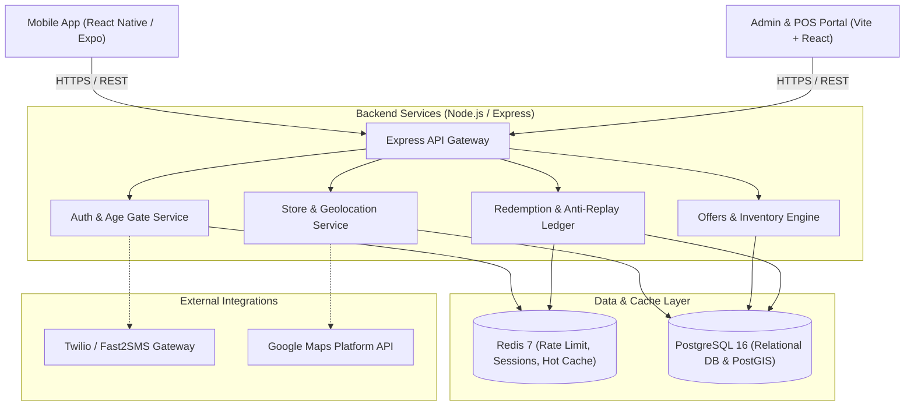

# BottleBazaar Architecture & Technical Design

## 1. System Overview

BottleBazaar is an Indian liquor discovery and in-store discount marketplace engineered specifically to conform with India's central (FSSAI) and state-level excise regulations.

## 2. Key Architecture Decisions

### In-Store Only Redemption Paradigm
- In India, direct home delivery of alcohol is strictly illegal in most states without explicit state authorization.
- BottleBazaar intentionally does not contain payment processing for alcohol or home delivery logistics.
- All transactions culminate in a cryptographic, single-use **in-store voucher** presented physically at the licensed merchant counter.

### Multi-State Legal Drinking Age (LDA) Engine
- **Maharashtra & Delhi**: Minimum legal age is **25** for hard spirits.
- **Goa & Karnataka**: Minimum legal age is **21**.
- The API and mobile app dynamically enforce state-specific threshold checks based on store location and user self-declaration.

### Anti-Fraud & Replay Prevention
- Redemptions generate an ephemeral, signed token (`BB-XXXXXX`) with a 30-minute validity window.
- The Redis atomic lock (`SETNX`) ensures that even if two cashiers or requests hit simultaneously with the same code, only one succeeds; subsequent attempts are recorded as rejected replay attempts.
