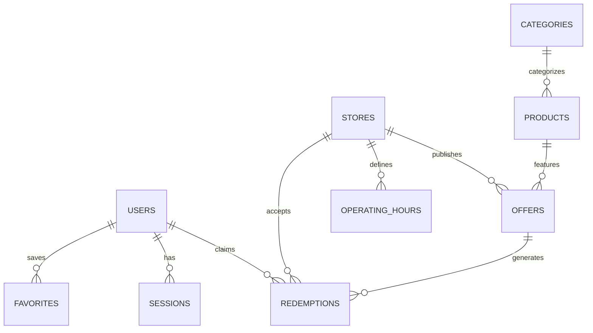

# BottleBazaar Database Architecture

BottleBazaar uses **PostgreSQL 16** with **PostGIS** for spatial calculations and **Redis 7** for ephemeral sessions, rate-limiting counters, and distributed locking.

## Schema Architecture

## Core Tables

### 1. `users`
- `id` (UUID PK)
- `phone_number` (VARCHAR(15) UNIQUE)
- `role` (VARCHAR(20) DEFAULT 'USER')
- `age_declared` (BOOLEAN DEFAULT FALSE)
- `age_declaration_date` (TIMESTAMPTZ)
- `created_at` (TIMESTAMPTZ)

### 2. `stores`
- `id` (UUID PK)
- `owner_id` (UUID FK -> users)
- `name` (VARCHAR(255))
- `license_number` (VARCHAR(100) UNIQUE)
- `license_expiry` (DATE)
- `address_line1` (TEXT)
- `city` (VARCHAR(100))
- `state` (VARCHAR(100))
- `pincode` (VARCHAR(10))
- `location` (GEOMETRY(Point, 4326))
- `is_verified` (BOOLEAN DEFAULT FALSE)

### 3. `offers`
- `id` (UUID PK)
- `store_id` (UUID FK -> stores)
- `title` (VARCHAR(255))
- `discount_type` (VARCHAR(30)) — PERCENTAGE, FLAT, BOGO
- `discount_value` (NUMERIC(10, 2))
- `min_purchase_amount` (NUMERIC(10, 2))
- `valid_from` (TIMESTAMPTZ)
- `valid_until` (TIMESTAMPTZ)
- `is_active` (BOOLEAN DEFAULT TRUE)

### 4. `redemptions`
- `id` (UUID PK)
- `user_id` (UUID FK -> users)
- `offer_id` (UUID FK -> offers)
- `store_id` (UUID FK -> stores)
- `token_code` (VARCHAR(20) UNIQUE)
- `status` (VARCHAR(20)) — CLAIMED, REDEEMED, EXPIRED
- `claimed_at` (TIMESTAMPTZ)
- `expires_at` (TIMESTAMPTZ)
- `redeemed_at` (TIMESTAMPTZ NULL)
- `bill_amount` (NUMERIC(10, 2) NULL)
- `discount_amount` (NUMERIC(10, 2) NULL)
